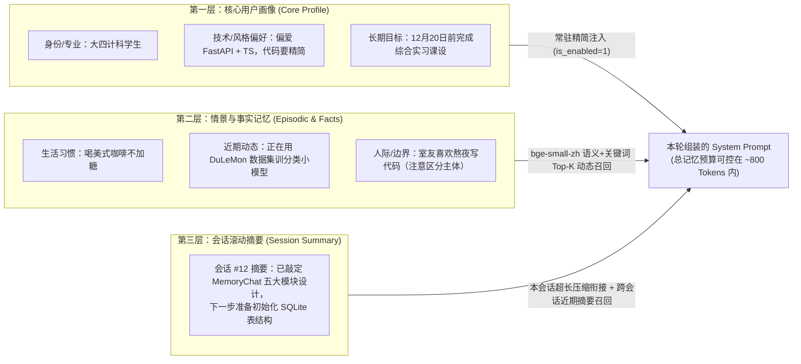

# 模块三：分层个人记忆与存储检索设计

本文档定义 MemoryChat 最核心的业务底座——**类 Gemini 的分层个人记忆与跨会话上下文总结系统**。本模块彻底摒弃繁琐冗余的“企业级本地外部文档库”，使用单个轻量 SQLite 数据库专职管理**会话历史、三层个人记忆与语义向量**。

---

## 1. 为什么需要“分层记忆”而不是只存一堆碎句子？

如果把用户说过的每一句话都一视同仁塞进向量库，很快就会出现两个问题：
1. **核心身份丢失**：用户问“帮我写个后端接口”，这句话和“我是 Python FastAPI 开发者”字面语义并不直接相似，纯靠向量检索可能漏掉最关键的身份背景；
2. **缺乏近期连贯性**：用户新开一个窗口说“接着昨天聊的数据库表继续改”，单条碎片记忆无法还原昨天聊到哪一步了。

因此，MemoryChat 将个人上下文划分为职责清晰的**三层结构**：



| 记忆层级 | 存什么内容 | 注入对话的策略 | 生命周期与更新方式 |
| :--- | :--- | :--- | :--- |
| **1. 核心画像（`profile`）** | 用户的稳定身份、职业/学业背景、语言与回复风格偏好、核心技术栈。 | **常驻注入**：凡 `is_enabled=1` 的核心画像条目（通常 5～15 条，总计 `< 250 tokens`）默认拼入每次对话的 `<user_profile>` 块。 | 冲突时执行 `UPDATE` 替换旧表述（旧条目标记 `archived` 可回溯）。 |
| **2. 情景与事实记忆（`episodic`）** | 具体的日常习惯、喜恶细节、阶段性任务、特定事件与约定。 | **按需混合召回**：发消息前由本地 `bge-small-zh-v1.5` 向量余弦相似度 + 关键词匹配，动态召回最相关的 `Top-K`（默认 5 条）。 | 随对话持续沉淀；支持手动置顶（升为常驻）或删除。 |
| **3. 会话滚动摘要（`session_summary`）** | ① 当前长对话较早轮次的浓缩总结；② 历史会话的核心结论摘要。 | **双途复用**：本会话消息超过滑动窗口（如最近 10 条原文）时自动顶替早期历史防爆窗；新会话提到过往话题时亦可按向量召回最近摘要。 | 每满 N 轮对话或切换/结束会话时后台增量更新。 |

---

## 2. SQLite 轻量数据库全量表结构（`schema.sql`）

全系统加上模型配置表总共仅 **5 张表**，单文件存储在本地 `data/memorychat.db`（开启 WAL 模式支持读写并发），无任何外部数据库服务依赖：

```sql
PRAGMA journal_mode = WAL;
PRAGMA foreign_keys = ON;

-- 1. 模型供应商配置表（见模块一&二）
CREATE TABLE IF NOT EXISTS model_providers (
    id TEXT PRIMARY KEY,
    name TEXT NOT NULL,
    base_url TEXT NOT NULL,
    api_key TEXT DEFAULT '',
    models_json TEXT NOT NULL,
    is_enabled INTEGER DEFAULT 1,
    created_at TEXT NOT NULL
);

-- 2. 会话表
CREATE TABLE IF NOT EXISTS conversations (
    id TEXT PRIMARY KEY,
    title TEXT NOT NULL,
    active_provider_id TEXT,
    active_model TEXT,
    memory_enabled INTEGER DEFAULT 1,      -- 1: 启用记忆读写, 0: 无痕对话模式
    active_skills_json TEXT DEFAULT '[]',  -- 当前会话显式挂载的 SKILL 名称列表
    created_at TEXT NOT NULL,
    updated_at TEXT NOT NULL
);

-- 3. 聊天消息表
CREATE TABLE IF NOT EXISTS messages (
    id TEXT PRIMARY KEY,
    conversation_id TEXT NOT NULL REFERENCES conversations(id) ON DELETE CASCADE,
    role TEXT NOT NULL CHECK(role IN ('user', 'assistant', 'tool')),
    content TEXT NOT NULL,
    model_used TEXT,
    tool_calls_json TEXT,                  -- 记录触发的 Agent 工具调用与结果
    memory_refs_json TEXT DEFAULT '[]',    -- 记录本轮回答参考的记忆 ID 与得分
    memory_events_json TEXT DEFAULT '[]',  -- 记录本轮触发的新增/更新记忆事件
    created_at TEXT NOT NULL
);

-- 4. 个人记忆主表（核心画像 + 情景事实统一存储）
CREATE TABLE IF NOT EXISTS memories (
    id TEXT PRIMARY KEY,
    layer TEXT NOT NULL CHECK(layer IN ('profile', 'episodic')),
    category TEXT NOT NULL DEFAULT 'general', -- 如 'identity', 'preference', 'habit', 'project'
    content TEXT NOT NULL,                    -- 精炼后的第三人称事实陈述，如“用户偏好使用 FastAPI 开发后端”
    source_message_id TEXT REFERENCES messages(id) ON DELETE SET NULL,
    source_quote TEXT,                        -- 触发该记忆的用户原话摘录（供溯源核对）
    confidence REAL DEFAULT 1.0,              -- MemoryGate 分类置信度（人工创建为 1.0）
    embedding_blob BLOB,                      -- bge-small-zh-v1.5 生成的 512 维 float32 归一化向量 (2048 字节)
    is_pinned INTEGER DEFAULT 0,              -- 1: 强制常驻注入上下文
    is_enabled INTEGER DEFAULT 1,             -- 1: 允许注入上下文, 0: 用户手动暂停使用
    status TEXT NOT NULL DEFAULT 'active' CHECK(status IN ('active', 'archived')),
    replaced_by_id TEXT,                      -- 若偏好改变被更新，指向新记忆 ID 保留演变链
    created_at TEXT NOT NULL,
    updated_at TEXT NOT NULL
);

-- 5. 会话滚动摘要表（上下文总结）
CREATE TABLE IF NOT EXISTS session_summaries (
    id TEXT PRIMARY KEY,
    conversation_id TEXT NOT NULL UNIQUE REFERENCES conversations(id) ON DELETE CASCADE,
    summary_text TEXT NOT NULL,               -- 阶段性总结正文（已讨论背景、关键决定、待办事项）
    key_topics_json TEXT DEFAULT '[]',        -- 关键词标签列表
    covered_until_msg_id TEXT,                -- 摘要已覆盖到的最后一条消息 ID
    embedding_blob BLOB,                      -- 摘要的 512 维语义向量，支持跨会话回忆过往讨论
    updated_at TEXT NOT NULL
);
```

---

## 3. 检索召回与上下文拼装算法（轻量、透明、好讲解）

个人记忆总量一般在几十到几千条规模，完全不需要引入笨重的独立向量数据库（Milvus / Chroma），直接用 **`SQLite + NumPy` 矩阵点积 + 关键词加分** 即可在 **1～3 毫秒**内完成精确检索：

### 3.1 混合检索打分公式（`backend/ml/embedder.py`）

1. **向量语义分 $S_{\text{vec}}$**：
   - 查询句加上 BGE 官方检索前缀 `"为这个句子生成表示以用于检索相关文章："`，经 `bge-small-zh-v1.5` 输出 L2 归一化的 512 维 `float32` 向量 $q$。
   - 从 SQLite 读取所有 `status='active' AND is_enabled=1` 的非常驻记忆向量，通过 `np.frombuffer(blob, dtype=np.float32)` 堆叠为矩阵 $M_{N \times 512}$，一行代码 `scores = M @ q` 得到精确余弦相似度。
2. **关键词字面匹配奖励分 $S_{\text{kw}}$**：
   - 提取查询中的核心实词/专有名词（如 `FastAPI`、`DuLeMon`、`室友`），若直接命中记忆正文或标签，给予 `+0.15` 的精确匹配奖励（弥补纯稠密向量对英文缩写/专名偶发漂移的短板）。
3. **最终排序与阈值截断**：
   - 综合得分 $S = 0.85 \cdot S_{\text{vec}} + 0.15 \cdot S_{\text{kw}}$；
   - 过滤掉低于用户设定阈值（默认 `0.45`）的无关项，取前 `Top-K`（默认 5 条）情景记忆 + Top-2 相关历史会话摘要。

### 3.2 注入大模型的 System Prompt 模板结构

```xml
你是 MemoryChat 个人 AI 助手。请自然地结合以下已知的用户背景与历史上下文来回答，无需生硬背诵设定；若用户当前问题与某条记忆无关，请忽略该记忆。

<user_profile>
- [identity] 大四计算机科学与技术专业学生
- [preference] 写 Python 后端偏爱 FastAPI 与 Pydantic，代码风格要求精简直观
</user_profile>

<relevant_memories>
- [project] 正在完成《计算机应用综合实习》课设，截止时间为 2026-12-20
</relevant_memories>

<recent_session_summaries>
- [2026-11-25 课设架构讨论] 确定采用方案 A（MemoryGate 门控分类器 + bge-small-zh 检索联动）重构个人记忆聊天端。
</recent_session_summaries>
```

---

## 4. 记忆提炼、冲突更新与防污染机制（`backend/memory/pipeline.py`）

当自训小模型 `MemoryGate`（详见模块四）判定本轮用户发言包含值得记录的信息后，进入结构化提炼与去重合并步骤：

1. **先查旧账防重复**：用 `bge-small-zh-v1.5` 在现有 `active` 记忆中找出语义最相近的 Top-3 旧记忆（例如库里已有 `[m_04] 用户喝咖啡习惯加全糖`）。
2. **大模型结构化增量决策**：将「本轮用户原话 + Top-3 相近旧记忆」一并交给后台整理模型，严格输出 JSON 操作列表：
   - **`ADD`**：全新事实（例如原话“我最近对 Rust 很感兴趣” → 新增一条 `episodic` 记忆）；
   - **`UPDATE`**：偏好改变或细节补充（例如原话“我现在戒糖了，以后只喝无糖美式” → 将旧记忆 `m_04` 置为 `archived`，新建 `m_21`“用户喝咖啡习惯无糖美式”并设置 `m_04.replaced_by_id = 'm_21'`）；
   - **`NONE`**：复核发现主体并非用户本人（例如“我室友从来不吃辣”且与用户自身无关）、纯属单次临时指令（“把上面这段话翻译成英文”）、或库内已完全包含该信息 → 不做任何写入。
3. **会话滚动摘要更新策略**：
   - 每个会话维护最近 `10` 条原始消息不压缩；当未覆盖的更早消息攒满 `8` 条时，后台异步将「旧 `summary_text` + 这 8 条消息」交由模型浓缩为 300 字以内的更新版摘要（保留关键上下文、决定与未完事项），并重算摘要向量存入 `session_summaries`。
