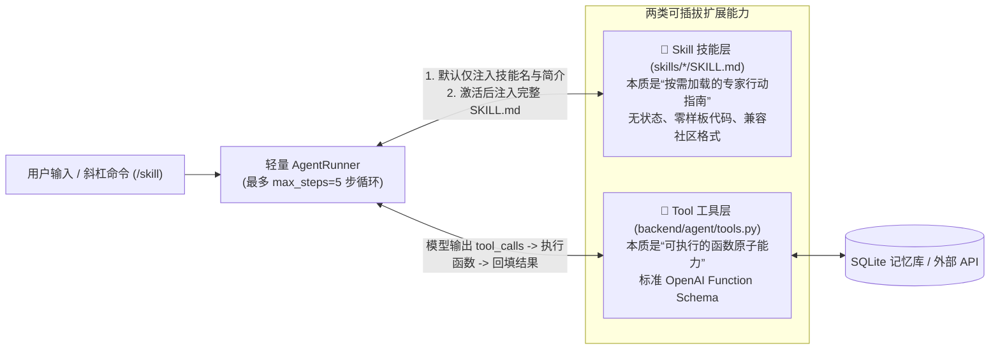

# 模块五：Agent 循环与 Skill 插件机制设计（二期扩充规划 & 一期插槽契约）

> **阶段实施说明**：根据分步迭代原则，**一期基础框架（v1.0 Foundation）优先聚焦「极简图形化 Chat 端 + 多模型自由切换 + 三层个人记忆 + 方案 A 双小模型联动」**，并在前后端预留标准化的扩展协议槽位（`backend/app/extensions/interfaces.py` 与前端输入舱图标插槽：`🎤 语音`、`🧩 Skill`、`🔧 工具`）。本文档定义的完整 Agent 多步工具循环、`SKILL.md` 插件生态与轻量语音输入作为**二期无缝扩充模块**接入。

本文档定义 MemoryChat 的多功能扩展层。设计原则非常明确：**不重复造臃肿的自定义 YAML 工作流编译器，直接借鉴并对齐现有 `Pi`（`pi-agent-core`）与 `DSH`（`deepseek-harness`）成熟轻量的「多步 Tool 循环 + `SKILL.md` 渐进式披露」架构**，用最精炼透明的代码让 Chat 端具备主动管理记忆与挂载领域技能的能力。

---

## 1. 架构分层：Agent、Tool 与 Skill 各司其职

参考 Pi / DSH 的设计哲学，将 Agent 扩展能力拆为极简的三层：



1. **AgentRunner（推理循环层）**：负责驱动一次对话内的 `LLM 请求 → 解析 tool_calls → 执行本地函数 → 将结果追加回消息流继续生成` 循环（上限 5 步防死循环），每一步状态通过 SSE 实时反馈给前端。
2. **Tool（原子工具层）**：基于标准 JSON Schema 注册的 Python 异步函数，赋予大模型“动手能力”（尤其是**主动读写个人记忆库**的能力）。
3. **Skill（场景技能插件层）**：完全照搬 `Agent Skills`（Pi / DSH / Claude Code 通用规范）的目录结构 —— **一个文件夹 + 一份带 YAML 头部的 `SKILL.md` 就是插件**，放入 `skills/` 目录重启或刷新即自动识别！

> **可选高级兼容说明**：由于 `AgentRunner` 接口完全解耦，若后续想实验直接调用 `deepseek-harness-sdk`（DSH）执行本地编码类重任务，仅需在 `agent/runner.py` 增加一个可选的 `DSHRunner` 分支即可，主线保持纯 Python 原生轻量循环以便于代码讲解。

---

## 2. 内置核心工具集（让 AI 像 Gemini 一样主动管记忆）

除了后台异步的 `MemoryGate` 自动沉淀外，当用户在对话里**明确下达指令**（例如：“记住我以后写前端一律用 Tailwind，别给我写原生 CSS” 或 “查一下我上个月聊过的书单”），模型可以通过内置工具**当场同步响应**，体验丝滑直观：

| 工具名称 | 参数 Schema 简述 | 核心作用 | 安全与交互策略 |
| :--- | :--- | :--- | :--- |
| **`memory_search`** | `query: str, limit: int = 5` | 当默认 Top-K 注入不够用（如用户追问久远细节）时，模型主动深搜全量记忆与历史会话摘要。 | 只读免确认，前端展示 `🔍 主动检索了历史记忆`。 |
| **`memory_upsert`** | `layer: 'profile'\|'episodic', category: str, content: str, replace_id?: str` | 用户显式要求“记住…”或“把某条偏好改成…”时，模型当场写入或更新 SQLite 记忆并生成向量。 | 写入后立即点亮气泡下方 `✨ 已记住` 胶囊（带一键撤销按钮）。 |
| **`memory_forget`** | `keyword_or_id: str` | 用户显式要求“忘掉我之前说的某件事”时，将匹配记忆归档停用。 | 软归档（`status='archived'`），可在记忆面板恢复，防误删。 |
| **`load_skill`** | `skill_name: str` | 当模型从 `<available_skills>` 发现某个技能契合当前任务时，主动调用此工具读取该技能完整的 `SKILL.md` 正文。 | 只读免确认，实现真正的按需渐进式披露。 |
| **`web_reader`** | `url: str` | 抓取指定网页正文摘要（例如用户丢进一个文档链接让助手结合个人背景解读）。 | 限制超时与返回长度（`<= 4000` 字符），仅抓 HTTP/HTTPS 公开文本。 |

---

## 3. `SKILL.md` 插件协议与渐进式披露实现

### 3.1 标准插件格式（零学习成本，直接照搬通用规范）

每个插件位于 `skills/<skill-name>/SKILL.md`，由顶部 YAML Frontmatter 和下方 Markdown 指导正文组成：

```markdown
---
name: study-planner
description: 结合用户的专业背景、作息偏好与截止日期，拆解可执行的学习或项目阶段计划。当用户请求制定复习计划、课设排期或任务拆解时激活。
---

# 个性化学习与任务拆解技能

当执行此技能时，请按以下步骤协助用户：
1. **核对已知背景**：先检查 `<user_profile>` 和 `<relevant_memories>` 中是否已有用户的专业基础、每日高效时间段（如早起型/夜猫子）及目标截止日期；若缺少关键时间节点，先用一两句话简短询问。
2. **结构化拆解**：按里程碑输出阶段目标、每日预计投入时长与可验收产出物，避开用户不喜欢的学习方式。
3. **沉淀关键节点**：若用户在确认计划时明确了新的截止日期或长期目标，主动调用 `memory_upsert` 将该节点记入个人记忆。
```

### 3.2 渐进式披露（Progressive Disclosure）工作流

为了不让十几个插件把每次聊天的上下文塞满，`backend/agent/skills.py`（仅约 70 行代码）采用与 Pi / DSH 相同的两阶段加载机制：

1. **阶段一：轻量目录注入（仅耗几十 Tokens）**
   启动时扫描 `skills/*/SKILL.md` 的 YAML 头部，在 System Prompt 末尾仅附上简表：
   ```xml
   <available_skills>
   - persona-onboarding: 通过轻松的破冰问答快速了解新用户的身份、喜好与日常目标并建立初始个人画像。
   - context-summarizer: 跨会话梳理用户近期推进的项目脉络、已完成进展与待办事项。
   - study-planner: 结合用户的专业背景、作息偏好与截止日期，拆解可执行的学习或项目阶段计划。
   </available_skills>
   如需使用某项技能，请调用 `load_skill` 工具读取其完整操作指南。
   ```
2. **阶段二：按需激活（双触发入口）**
   - **用户显式挂载**：用户在聊天输入框输入 `/` 弹出技能菜单点选 `/study-planner`，后端直接将该技能的 `SKILL.md` 正文拼入本轮上下文；
   - **模型自动激活**：用户自然语言说“帮我排一下接下来两周赶课设的计划”，主模型看到 `<available_skills>` 描述匹配，自动先调一次 `load_skill("study-planner")` 拿到完整指导手册，再结合个人记忆输出高质量排期！

### 3.3 首批内置的 3 个实用个人助手 Skill

1. **`persona-onboarding`（新用户破冰画像助手）**：新安装系统记忆库为空时一键点击，AI 以自然聊天方式花 3～4 轮了解你的称呼、领域、回复风格喜好，边聊边调 `memory_upsert` 填满右侧画像面板（**录屏演示开场神器！**）。
2. **`context-summarizer`（个人上下文周报/复盘助手）**：自动调用 `memory_search` 汇总最近几次会话摘要与近期事项，为你生成一份清晰的“近期关注焦点与待推进事项清单”。
3. **`study-planner`（个性化任务规划助手）**：结合记忆库里的作息习惯与技术栈水平，定制贴合你个人节奏的任务计划。
