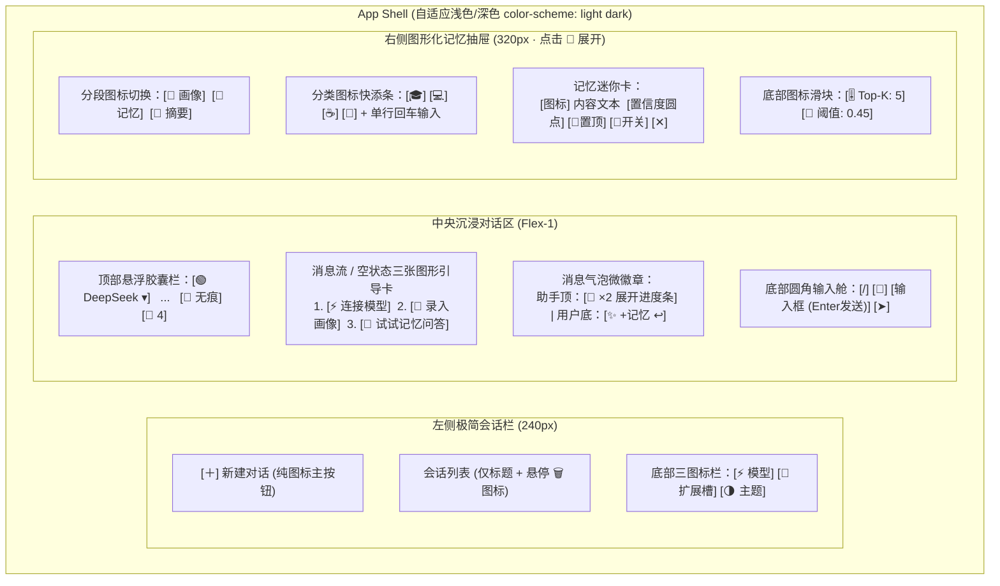

# 模块六：UI/UX 视觉与图形化引导设计规范

本文档定义 MemoryChat 基础框架的 UI/UX 设计准则。核心设计理念为**“克制文字、图形先行、微交互透明”**——拒绝大段说明文字与表单噪音，通过**图标徽章、品牌预设卡片、胶囊状态点与直觉开关**自然引导用户完成“接入模型 → 对话 → 感知与调控个人记忆”的完整闭环。

---

## 1. 核心 UX 四大准则

1. **零段落空状态（Action Cards 替代文字教程）**
   - 首次进入或新建对话时，不展示冗长的功能说明段落，仅居中呈现品牌脑波图形徽标与 **3 张图标化快捷动作卡**（每卡仅含「大号矢量图标 + 4～6 字动宾短标题」），点击即触发对应交互。
2. **胶囊与角标反馈（Micro-Badges 替代系统提示框）**
   - 废除打断聊天的 Toast 文字弹窗与啰嗦的系统横幅：
     - **读记忆反馈**：助手消息上方仅渲染紧凑胶囊 `[🧠 ×2]`，点击才展开查看命中的记忆卡片及相似度进度条；
     - **写记忆反馈**：当后台 `MemoryGate` 小模型捕获新画像/偏好时，用户消息右下角柔和滑出 `[✨ + FastAPI 偏好  ↩]`，点 `↩` 图标即可单步撤销。
3. **品牌图标一键预设（Visual Presets 替代手填 URL）**
   - 模型配置弹窗顶部采用 **品牌图标网格（DeepSeek / Gemini / OpenAI / Ollama / 本地体验）**：点击任意品牌卡片即自动填好 `Base URL` 与推荐模型胶囊，用户只需粘贴 `API Key` 点 `✓` 即可开聊；未配 Key 时默认启用内置**免 Key 演示引擎**，开箱即可体验完整记忆链路。
4. **预留扩展视觉槽位（Extension Slots）**
   - 输入框工具栏采用纯图标按钮排布，对二期扩充的 `🎤 语音 (ASR)`、`🧩 技能 (Skill)`、`🔧 工具 (Tool)` 提供统一的轻量图标槽位（一期置为可扩展插槽状态），保持界面骨架前后端一致，后续扩充无需推翻布局。

---

## 2. 界面信息架构与视觉线框图

---

## 3. 关键视觉组件与交互映射表

| 界面区域 | 传统啰嗦设计（弃用） | MemoryChat 图形引导设计（采用） | 无障碍与现代 Web 标准保障 |
| :--- | :--- | :--- | :--- |
| **顶部模型状态** | 文字提示“当前未配置 API Key，请前往设置页填写接口地址” | 胶囊按钮 `[🟠 Demo ▾]` / `[🟢 DeepSeek ▾]`，呼吸圆点颜色直接表达就绪状态，点击即弹品牌卡 | 原生 `<button>` 附明确 `aria-label` |
| **无痕对话切换** | 复选框 + 说明“开启后本会话不读取也不保存个人记忆” | 单个幽灵图标按钮 `[👻]`：默认半透明，激活后亮起紫色柔光背景，输入框边框同步变为虚线视觉暗示 | `aria-pressed="true/false"` + 简短 `title` |
| **记忆中心开关** | “打开个人记忆管理侧边栏”文字按钮 | 大脑图标 + 实时数字角标 `[🧠 4]`；新增记忆时角标执行 1 次轻弹缩放动画引导视线 | 角标数值实时反映生效中的记忆总数 |
| **模型接入弹窗** | 4 个空白文本框让用户自己查文档填 Base URL 和模型 ID | 原生 `<dialog closedby="any">` 模态框 + **5 张品牌 Logo 卡**，点选自动填好端点与模型标签胶囊 | 支持点击遮罩 Light-Dismiss 与 `Esc` 关闭，含坐标边界降级兜底 |
| **单条记忆调控** | 下拉菜单“置顶 / 停用 / 删除 / 查看详情” | 卡片右侧三个直觉小图标：`📌`（常驻点亮）、`🔘`（拨动开关控制是否注入）、`✕`（归档移除） | 所有装饰 SVG 标 `aria-hidden="true"`，按钮具独立 `aria-label` |

---

## 4. 色彩与动效 Token（CSS `light-dark()` 自适应）

- **色彩语义**：采用 `color-scheme: light dark` 搭配 `@media (prefers-color-scheme: dark)` 与 `light-dark()` 双重渐进增强：
  - **主品牌色（记忆紫蓝）**：浅色 `#4f46e5` / 深色 `#818cf8`（用于已激活记忆胶囊、置顶图钉、发送主按钮）；
  - **记忆捕获高光色（琥珀金）**：浅色 `#d97706` / 深色 `#fbbf24`（用于 `✨` 新记忆生成提示）；
  - **模型在线状态点（翡翠绿）**：`#10b981`；**无痕模式态（幽灵紫）**：`#a855f7`。
- **克制动效**：仅保留两处有信息价值的微动效——流式生成时的呼吸圆点光标、以及新记忆入库时右上角 `[🧠 N]` 角标的 `scale(1.18)` 轻弹反馈（遵循 `prefers-reduced-motion` 自动减弱）。
