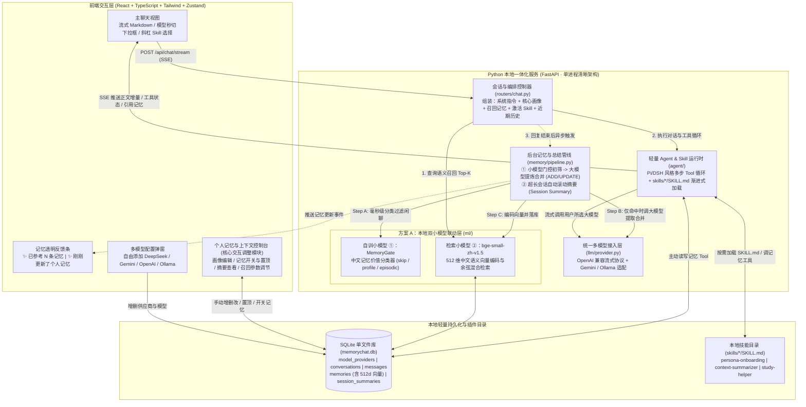
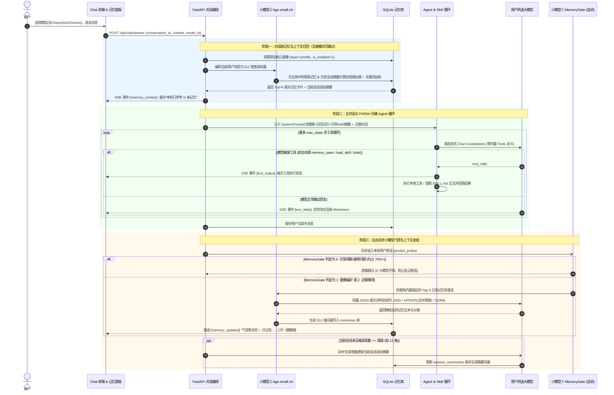

# MemoryChat 产品设计与分期开发方案（v1.0）

> **版本说明**：本方案结合最初的“类 Gemini 个人记忆型多功能 Chat 端”产品构想与《计算机应用综合实习任务书》（2026-12-20 截止）要求制定。砍掉了脱离个人场景的“权威本地文档库、重型 LiveKit 实时音视频栈、黑盒强制模型路由、自造 YAML 工作流引擎”，聚焦**个人上下文记忆总结、多模型自由切换、小模型高效门控与检索联动（方案 A）、以及 Pi/DSH 风格的轻量 Agent/Skill 扩展**。

---

## 1. 产品核心愿景与课设任务书映射

MemoryChat 首先是一个**清爽好用的多模型 AI 聊天客户端**，它的核心差异化体验是**“越聊越懂你，且记忆透明可控”**：
- 像使用 Gemini / ChatGPT Memory 一样，你在不同会话里随口提过的专业背景、代码技术栈偏好、饮食作息习惯、近期正在忙的项目，AI 都会自动识别并沉淀成精炼的个人记忆卡片；
- 当一段对话变长或开启新会话时，AI 能对历史上下文做阶段性总结，跨会话无缝接续（如“按我平时的技术栈习惯，接着昨天的方案往下设计”）；
- 同时它不是黑盒：每轮回答引用了哪条记忆、刚刚新增或修改了哪条画像，界面都会给出轻量提示，用户随时可以在右侧**「记忆与上下文面板」**里增删改查、手动置顶或一键关闭。

### 与《计算机应用综合实习任务书》逐条对齐表

| 任务书硬性要求 | MemoryChat 对应设计与交付内容 | 优势说明 |
| :--- | :--- | :--- |
| **1. 选取大模型作为基础支撑** | 内置统一多模型接入层，支持用户自由配置并切换 DeepSeek、Gemini、通义千问、OpenAI 兼容接口或本地 Ollama 大模型。 | 无需锁死单一模型，演示时可直观展示切换不同大模型共享同一套个人记忆库。 |
| **2. 构建适应主题的小模型联动调优** | **方案 A 双小模型联动**：① 自训中文记忆价值分类小模型 `MemoryGate`（毫秒级筛除 70%+ 无关闲聊，防大模型乱记与浪费 Token）；② 本地 `bge-small-zh-v1.5` 语义向量小模型（毫秒级精准召回相关记忆）。 | 小模型切口精准贴合“记忆”主题，训练快、推理快（CPU 几毫秒），代码逻辑极其清晰。 |
| **3. 下载公开数据集测试与调优分析** | 下载百度千言公开中文长程对话记忆数据集 **`DuLeMon`**，用于训练 `MemoryGate`（对比 TF-IDF+LR 与轻量预训练微调），并完成“无记忆 vs 纯大模型硬抽 vs 大小模型联动”三组对比实验。 | 数据集本身就是“中文多轮对话 + 用户画像记忆”，与系统功能 100% 同构，无需生凑阅读理解库。 |
| **4. 包含用户可交互调整的模块（不完全依赖大模型）** | **可视化记忆中心与上下文控制器**：支持手动新增/编辑用户画像、单条记忆启用/禁用/置顶、调节记忆召回条数与相似度阈值、挂载 `SKILL.md` 技能、开关无痕模式。 | 交互直观可见，录屏演示时调节开关即可看到模型回复风格的实时变化。 |
| **5. 7–14 分钟录屏 + 逐行讲解代码 + 防抽检** | 采用 **Python FastAPI 单后端 + React 轻量前端**，总核心业务代码严格控制在 **~1,500 行**，按五大模块高内聚拆分，无跨语言子进程冗余胶水代码。 | 每一行代码职责单一明确，10 分钟内既能完整演示成果，又能从容讲透核心代码逻辑。 |

---

## 2. 技术路线选型对比（Approaches）

围绕“既要复用 Pi / DSH 的 Agent 与 Skill 思想，又要跑 Python 小模型并方便逐行讲代码”，评估以下三种实现路线：

| 候选技术路线 | 架构形态 | 优点 | 缺点与录屏讲解代价 | 结论 |
| :--- | :--- | :--- | :--- | :--- |
| **路线一（选定方案）：Python 一体化后端 + Pi/DSH 兼容轻量 Agent/Skill 引擎** | `React 前端` ↔ `Python FastAPI`（统一承载多模型调用、轻量 Agent 循环、`SKILL.md` 加载器、SQLite、`MemoryGate` 与 `bge-small-zh`） | 仅 **1 个后端进程**；小模型、向量计算与业务逻辑零跨进程通信；直接读取标准 `skills/*/SKILL.md`；代码最精简（后端 ~900 行），极易逐行讲解。 | 需在 Python 内用约 120 行代码实现标准的 OpenAI Tool-Calling 循环与 `SKILL.md` 解析（逻辑反而比调外部黑盒框架更透明）。 | **默认采用**（并保留可选适配器挂载 `deepseek-harness-sdk`）。 |
| **路线二：Python 主服务 + Node.js (`Pi Agent Core`) 双后端进程** | `React 前端` ↔ `FastAPI (记忆/小模型)` ↔ `Node Sidecar (Pi Agent Core)` | 可直接 `import` npm 上的 `@earendil-works/pi-agent-core` 原包。 | 需同时维护 Python 与 Node 两套后端运行时及自定义 stdin/stdout NDJSON 进程通信协议，多出数百行管道容错代码，录屏讲解负担重。 | 不推荐作为课设主线。 |
| **路线三：纯 Node/TS 全栈 + 外部 Python 小模型推理脚本** | `Next.js / Express (Pi)` ↔ `Python 小模型子服务` | 前后端同为 TypeScript。 | 课设重点考察的“小模型训练与联动”沦为边缘脚本，且需维护两个端口服务。 | 不符合课设重心。 |

---

## 3. 系统总体架构与完整流程链路

### 3.1 模块架构全景图



### 3.2 单次对话端到端时序图



---

## 4. 项目工程目录与代码体量规划（适配录屏逐行讲解）

为保证在 **7–14 分钟录屏**中从容讲清每一模块核心代码，全项目拒绝过度封装，结构扁平清晰：

```text
MemoryChat/
├── backend/                        # Python FastAPI 后端（核心代码约 850 行）
│   ├── main.py                     # 应用入口、CORS、生命周期初始化（~60 行）
│   ├── db/
│   │   ├── schema.sql              # 5 张核心 SQLite 表结构定义（~90 行）
│   │   └── repository.py           # 数据库读写封装（会话/消息/记忆/供应商）（~180 行）
│   ├── llm/
│   │   └── provider.py             # 多供应商统一流式客户端（DeepSeek/Gemini/OpenAI/Ollama）（~110 行）
│   ├── ml/
│   │   ├── memory_gate.py          # 自训小模型①：MemoryGate 加载与三分类推理（~90 行）
│   │   └── embedder.py             # 检索小模型②：bge-small-zh-v1.5 编码与混合相似度检索（~110 行）
│   ├── memory/
│   │   └── pipeline.py             # 记忆异步提炼合并（ADD/UPDATE）与会话滚动摘要管线（~140 行）
│   ├── agent/
│   │   ├── runner.py               # Pi/DSH 风格轻量 Agent 工具循环（~100 行）
│   │   ├── tools.py                # 内置工具注册表（主动记忆增删查、待办、时间等）（~90 行）
│   │   └── skills.py               # skills/*/SKILL.md 渐进式扫描与加载器（~70 行）
│   └── routers/
│       └── api.py                  # REST + SSE 路由（对话流、记忆 CRUD、模型配置、Skill 列表）（~140 行）
├── frontend/                       # React + TS + Tailwind 前端（核心组件约 650 行）
│   └── src/
│       ├── store/useChatStore.ts   # 全局状态（会话、模型切换、记忆抽屉、SSE 流解析）
│       ├── components/
│       │   ├── Sidebar.tsx         # 会话列表 + 模型配置入口 + Skill 管理入口
│       │   ├── ChatArea.tsx        # 聊天消息流 + 引用记忆折叠条 + 记忆更新胶囊 + 输入框
│       │   ├── MemoryDrawer.tsx    # 可视化记忆中心（核心画像/情景记忆/会话摘要 增删改查与开关）
│       │   └── ModelSettings.tsx   # 多模型供应商自由接入与测试弹窗
├── skills/                         # 兼容 Pi / DSH 规范的本地技能包
│   ├── persona-onboarding/SKILL.md # 破冰访谈：引导快速建立用户个人画像
│   ├── context-summarizer/SKILL.md # 跨会话复盘：汇总近期讨论的项目进展
│   └── study-planner/SKILL.md      # 结合个人作息偏好的学习与任务拆解
└── ml_experiments/                 # 课设小模型训练与对比评测独立目录（支撑实习报告）
    ├── download_dulemon.py         # 下载并清洗百度千言 DuLeMon 中文对话记忆数据集
    ├── train_memory_gate.py        # 训练 TF-IDF+LR 与轻量 RoBERTa 对照模型并导出权重
    └── eval_pipeline.py            # 跑三组大小模型对比实验并输出准确率/延迟/Token 图表
```

---

## 5. 分期开发排期（2026-11-25 至 2026-12-20）

| 阶段与时间 | 核心交付目标 | 验收标准 |
| :--- | :--- | :--- |
| **Phase 1：基础底座与多模型 Chat**（11/25 – 11/29） | 初始化 SQLite 5 张表、完成多模型配置与切换、跑通前后端 SSE 流式多轮对话。 | 在 UI 中添加 DeepSeek / Gemini / 本地模型 Key 后可自由切换流式聊天，刷新页面历史消息完整保留。 |
| **Phase 2：公开数据集与双小模型训练**（11/30 – 12/04） | 下载处理 `DuLeMon` 数据集，训练导出 `MemoryGate` 分类小模型，集成 `bge-small-zh-v1.5` 语义检索。 | 小模型单句推理 `< 10ms`，测试集宏 F1 达标，产出混淆矩阵与特征分析图可直接写入实习报告。 |
| **Phase 3：分层记忆闭环与可视化面板**（12/05 – 12/10） | 打通“检索注入 → 对话生成 → `MemoryGate` 筛选 → 大模型 `ADD/UPDATE` 提炼 → 会话滚动摘要”，完成前端 `MemoryDrawer` 交互面板。 | 跨会话说出偏好后自动弹出 `✨ 已记住`，新开会话提问能准确引用该记忆；面板关闭某条记忆后立即停止注入。 |
| **Phase 4：Agent 工具循环与 Skill 插件**（12/11 – 12/14） | 完成内置主动记忆工具（口头说“记住/忘掉”即时生效）与 `skills/*/SKILL.md` 加载器，补充浏览器轻量语音输入（可选点缀）。 | 输入 `/study-planner` 或自然对话可按需激活 `SKILL.md` 并调用工具完成多步任务。 |
| **Phase 5：对照评测、报告与录屏交付**（12/15 – 12/19） | 运行 `eval_pipeline.py` 生成大小模型对比数据图表，撰写《计算机综合应用实习报告》，录制“环境与成果演示 + 逐行代码精讲（带摄像头小窗）”7–14 分钟视频。 | 检查音量、画质与时长合规，按 `学号姓名` 打包在 12 月 20 日前提交。 |
