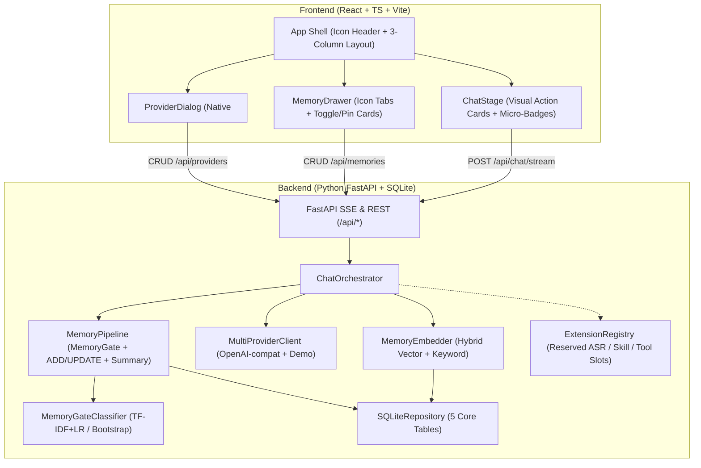

# MemoryChat Foundation Framework Implementation Plan

> **For agentic workers:** REQUIRED SUB-SKILL: Use superpowers:subagent-driven-development (recommended) or superpowers:executing-plans to implement this plan task-by-task. Steps use checkbox (`- [ ]`) syntax for tracking.

**Goal:** Build the clean, runnable MemoryChat v1.0 foundational framework (graphical icon-guided Chat UI, multi-provider LLM switcher with zero-key demo fallback, 3-layer SQLite personal memory & rolling summary engine, Plan A `MemoryGate` + `Embedder` small-model pipeline, and extensible hooks for future ASR/Skills/Tools) and submit a Pull Request.

**Architecture:** A single-process Python FastAPI backend (`backend/`) manages a 5-table SQLite database, a unified OpenAI-compatible multi-provider streaming client (with a built-in zero-key smart demo responder), the Plan A dual small-model memory pipeline (`MemoryGate` 3-class classifier + `MemoryEmbedder` hybrid vector/keyword retriever), and clean extension interfaces (`backend/extensions/`) reserved for Phase 2 ASR, Skills, and Tools. A React 18 + TypeScript + Vite frontend (`frontend/`) provides a minimal-copy, icon-and-card-guided chat experience with native `<dialog>` provider presets, micro-badge memory feedback, and a slide-out visual Memory Drawer.

**Architecture Diagram:**

**Tech Stack:** Python 3.11+ (`fastapi`, `uvicorn`, `pydantic`, `httpx`, `numpy`, `scikit-learn`, `pytest`), SQLite3 (WAL mode), React 18 + TypeScript + Vite + Lucide Icons + Vitest.

**Spec:** [MemoryChat产品设计与分期开发方案.md](file:///E:/AgentProject/MemoryChat/docs/MemoryChat产品设计与分期开发方案.md) & [05-UIUX视觉与图形引导设计.md](file:///E:/AgentProject/MemoryChat/docs/05-UIUX视觉与图形引导设计.md)

## Global Constraints

- Manage all Python packages strictly inside `backend/.venv` and freeze into `backend/requirements.txt`; never run global `pip install`.
- Core Phase 1 implements Chat UI, Multi-Model Switcher, 3-Layer Memory (`profile`, `episodic`, `session_summary`), and Plan A Small-Model Linkage; ASR, Skill plugins, and external Tools are exposed strictly as clean extension interfaces/slots (`backend/extensions/interfaces.py`) without bloated implementation.
- UI/UX must minimize instructional text: rely on visual brand preset cards, icon buttons with `aria-label`, status dots, and compact micro-badges (`[🧠 ×N]`, `[✨ +记忆 ↩]`).
- Native modal `<dialog closedby="any">` must open via `showModal()`, omit redundant `role="dialog"` / `aria-modal`, include scroll containment CSS, and provide a coordinate-checked click-outside fallback when `closedBy` is unsupported.
- Declare `<meta name="color-scheme" content="light dark">` and `:root { color-scheme: light dark; }` with `@media (prefers-color-scheme: dark)` fallback and `light-dark()` tokens.

## Review Focus

- Chatting immediately on a fresh clone with zero API keys configured must work end-to-end via the built-in `demo` provider without throwing network or auth errors.
- Sending a conversation message when `memory_enabled=False` (Incognito mode) must neither inject existing memories into the prompt nor write new candidate memories to SQLite.
- Toggling `is_enabled=False` on a memory card in the drawer must immediately exclude it from subsequent retrieval results without deleting it.
- Updating a conflicting preference (`UPDATE` action) must archive the superseded memory (`status='archived'`, setting `replaced_by_id`) so old preferences stop entering prompts.
- Empty or whitespace-only user messages and invalid provider IDs must return clean `422`/`404` HTTP errors rather than unhandled 500 tracebacks.

---

### Task 1: Backend Environment & SQLite 5-Table Repository

**Files:**
- Create: `backend/requirements.txt`
- Create: `backend/app/__init__.py`
- Create: `backend/app/db/schema.sql`
- Create: `backend/app/db/repository.py`
- Test: `backend/tests/test_repository.py`

**Interfaces:**
- Produces: `Repository(db_path: str | Path)` with synchronous/clean methods `init_db()`, `list_providers()`, `upsert_provider(...)`, `create_conversation(...)`, `list_conversations()`, `update_conversation(...)`, `delete_conversation(...)`, `add_message(...)`, `list_messages(conversation_id)`, `add_memory(...)`, `list_memories(layer=None, active_only=True)`, `update_memory(...)`, `archive_memory(memory_id, replaced_by_id=None)`, `upsert_summary(...)`, `get_summary(conversation_id)`.

- [ ] **Step 1: Initialize `backend/.venv`, install core backend & test packages, and write failing repository tests in `backend/tests/test_repository.py`** covering default `demo` provider seeding, conversation incognito flag, memory CRUD, and `archive_memory` replacement chain.
- [ ] **Step 2: Run `backend\.venv\Scripts\pytest.exe backend/tests/test_repository.py -v` and confirm RED failure.**
- [ ] **Step 3: Implement `backend/app/db/schema.sql` and `backend/app/db/repository.py` (WAL + foreign keys enabled).**
- [ ] **Step 4: Run `backend\.venv\Scripts\pytest.exe backend/tests/test_repository.py -v` and confirm GREEN pass.**

---

### Task 2: Plan A Small Models (`MemoryGate` Classifier & Hybrid `MemoryEmbedder`)

**Files:**
- Create: `backend/app/ml/memory_gate.py`
- Create: `backend/app/ml/embedder.py`
- Test: `backend/tests/test_small_models.py`

**Interfaces:**
- Consumes: `Repository` memory dictionaries (`id`, `content`, `category`, `embedding_blob`, `is_enabled`, `is_pinned`, `status`).
- Produces:
  - `MemoryGateClassifier`: `predict(text: str) -> GateDecision(label: Literal['skip', 'profile', 'episodic'], confidence: float, probs: dict[str, float])`, supporting saved `.joblib` weights from `DuLeMon` training plus built-in curated Chinese bootstrap corpus training on startup so it works out-of-the-box.
  - `MemoryEmbedder`: `encode(text: str, is_query: bool = False) -> np.ndarray` (512-d L2-normalized `float32`, auto-using `bge-small-zh-v1.5` when installed or deterministic char n-gram projection fallback) and `retrieve(query: str, memories: list[dict], top_k: int = 5, threshold: float = 0.25) -> list[dict]`.

- [ ] **Step 1: Write failing tests in `backend/tests/test_small_models.py`** verifying `MemoryGateClassifier` classifies chitchat ("哈哈哈好的谢谢") as `skip`, persona statements ("我是大四计算机专业学生，平时写Python偏爱FastAPI") as `profile`, recent plans ("这周五之前我要交课设报告") as `episodic`, and `MemoryEmbedder.retrieve` ranks relevant enabled memories above unrelated ones while excluding disabled/archived items.
- [ ] **Step 2: Run `backend\.venv\Scripts\pytest.exe backend/tests/test_small_models.py -v` and confirm RED failure.**
- [ ] **Step 3: Implement `backend/app/ml/memory_gate.py` (`TfidfVectorizer` char 1–3 gram + `LogisticRegression`) and `backend/app/ml/embedder.py` (512-d `float32` BLOB serialization + `0.85 * vec + 0.15 * keyword` hybrid scoring).**
- [ ] **Step 4: Run `backend\.venv\Scripts\pytest.exe -v` and confirm GREEN pass.**

---

### Task 3: Multi-Model Client, Memory Extraction Pipeline & Extension Hooks

**Files:**
- Create: `backend/app/llm/provider.py`
- Create: `backend/app/memory/pipeline.py`
- Create: `backend/app/extensions/interfaces.py`
- Test: `backend/tests/test_pipeline_and_llm.py`

**Interfaces:**
- Consumes: `Repository`, `MemoryGateClassifier`, `MemoryEmbedder`.
- Produces:
  - `MultiProviderClient`: `stream_chat(provider, model, messages)` (supports OpenAI-compatible SSE endpoints for DeepSeek/Gemini/OpenAI/Ollama plus built-in `demo` zero-key streaming responder) and `extract_memory_decision(provider, model, user_text, existing_memories) -> dict`.
  - `MemoryPipeline`: `build_system_prompt(query, memory_enabled, top_k, threshold) -> tuple[str, list[dict]]` and `process_turn_memory(conversation_id, message_id, user_text, provider, model, memory_enabled) -> dict | None` (runs `MemoryGate` → `ADD / UPDATE / NONE` + rolling `session_summaries` update).
  - `ExtensionRegistry` (`backend/app/extensions/interfaces.py`): clean protocol definitions & slot metadata for Phase 2 `VoiceProvider`, `SkillPlugin`, and `AgentTool`.

- [ ] **Step 1: Write failing tests in `backend/tests/test_pipeline_and_llm.py`** testing prompt assembly, incognito isolation (`memory_enabled=False`), `ADD` and `UPDATE` replacement archiving, rolling summary generation, and extension slot listing.
- [ ] **Step 2: Run `backend\.venv\Scripts\pytest.exe backend/tests/test_pipeline_and_llm.py -v` and confirm RED failure.**
- [ ] **Step 3: Implement `provider.py`, `pipeline.py`, and `extensions/interfaces.py`.**
- [ ] **Step 4: Run `backend\.venv\Scripts\pytest.exe -v` and confirm GREEN pass.**

---

### Task 4: FastAPI REST + SSE Endpoints

**Files:**
- Create: `backend/app/main.py`
- Test: `backend/tests/test_api.py`

**Interfaces:**
- Consumes: `Repository`, `MemoryGateClassifier`, `MemoryEmbedder`, `MultiProviderClient`, `MemoryPipeline`, `ExtensionRegistry`.
- Produces: FastAPI app (`create_app(db_path=None)`) serving `/api/health`, `/api/providers` (GET/POST/DELETE + preset metadata), `/api/conversations` (GET/POST/PATCH/DELETE), `/api/conversations/{id}/messages` (GET), `/api/memories` (GET/POST/PATCH/DELETE + undo), `/api/summaries/{conversation_id}` (GET), `/api/extensions/slots` (GET), and `/api/chat/stream` (POST SSE emitting `memory_context`, `text_delta`, `memory_updated`, `done`).

- [ ] **Step 1: Write failing API integration tests in `backend/tests/test_api.py`** exercising health check, provider CRUD, streaming chat with memory recall + auto-extraction + undo, incognito chat isolation, and empty-input `422` validation.
- [ ] **Step 2: Run `backend\.venv\Scripts\pytest.exe backend/tests/test_api.py -v` and confirm RED failure.**
- [ ] **Step 3: Implement `backend/app/main.py` and freeze `backend/requirements.txt`.**
- [ ] **Step 4: Run `backend\.venv\Scripts\pytest.exe -v` and confirm 100% GREEN suite.**

---

### Task 5: Icon-Guided Minimal-Copy React Frontend (`frontend/`)

**Files:**
- Create: `frontend/package.json`, `frontend/tsconfig.json`, `frontend/vite.config.ts`, `frontend/index.html`
- Create: `frontend/src/styles/theme.css`
- Create: `frontend/src/types.ts`, `frontend/src/api.ts`
- Create: `frontend/src/components/ProviderDialog.tsx`
- Create: `frontend/src/components/MemoryDrawer.tsx`
- Create: `frontend/src/components/ChatStage.tsx`
- Create: `frontend/src/App.tsx`, `frontend/src/main.tsx`
- Test: `frontend/src/__tests__/App.test.tsx`

**Interfaces:**
- Consumes: Backend `/api/*` REST & SSE endpoints (proxied via Vite `/api -> http://127.0.0.1:8000`).
- Produces: Accessible, minimal-text graphical UI featuring 3 visual empty-state starter cards, header status capsules (`Model`, `Incognito 👻`, `Memory 🧠 badge`), micro-badges (`[🧠 ×N]`, `[✨ +记忆 ↩]`), slide-out visual Memory Drawer (`👤 / 🧩 / 📝` icon tabs, category chips, pin/toggle/archive icon controls, `Top-K` & threshold sliders), native `<dialog closedby="any">` brand-card provider modal, and disabled/badged extension slot icons (`🎤`, `🧩`, `🔧`).

- [ ] **Step 1: Scaffold `frontend/`, install dependencies (`react`, `react-dom`, `lucide-react`, `vitest`, `@testing-library/react`, `jsdom`), and write failing UI component tests in `frontend/src/__tests__/App.test.tsx`** verifying visual starter cards render without walls of text, incognito toggle updates state, memory drawer toggles/filters layers, and provider preset selection populates fields.
- [ ] **Step 2: Run `npm --prefix frontend test -- --run` and confirm RED failure.**
- [ ] **Step 3: Implement `theme.css` (`color-scheme: light dark`, `light-dark()`, `dialog:modal` scroll containment), `App.tsx`, `ChatStage.tsx`, `MemoryDrawer.tsx`, and `ProviderDialog.tsx` (with `closedBy` coordinate fallback).**
- [ ] **Step 4: Run `npm --prefix frontend test -- --run && npm --prefix frontend run build` and confirm GREEN tests and clean production bundle.**

---

### Task 6: Final Git Hygiene, Full Verification & Pull Request Submission

**Files:**
- Create: `.gitignore`
- Modify: `README.md` (add quickstart commands for `backend` and `frontend`)

- [ ] **Step 1: Create root `.gitignore` excluding `.venv/`, `node_modules/`, `dist/`, `__pycache__/`, `.pytest_cache/`, `*.db*`.**
- [ ] **Step 2: Run full backend `pytest` suite, frontend `vitest` suite, frontend production `vite build`, and live FastAPI HTTP smoke check.**
- [ ] **Step 3: Stage all docs and source files on `feat/foundation-framework`, verify `git status` contains zero build artifacts or secrets, commit, push to `origin`, and open PR via `gh pr create`.**
